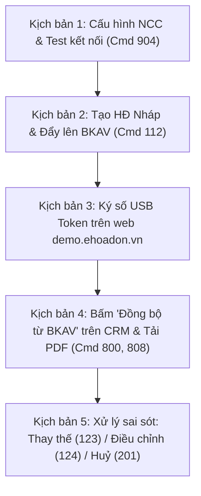

# Tài liệu Hướng dẫn & Danh mục Test Case Kiểm thử Module Hoá đơn Điện tử (BKAV eHoaDon)

> **Mục tiêu**: Cung cấp đầy đủ kịch bản kiểm thử thủ công (Manual Testing) cho toàn bộ tính năng Hoá đơn điện tử, bao quát tất cả các `CmdType` của BKAV eHoaDon WebService, các luồng nghiệp vụ trên CRM (B2B, B2C, Nạp tiền, Ký USB Token / HSM, Thay thế, Điều chỉnh, Huỷ, Tải file, Đồng bộ).
>
> **Môi trường Test**: BKAV WebService Demo (`https://wsdemo.ehoadon.vn/WSPublicEHoaDon.asmx`)  
> **Cổng Portal Kế toán BKAV**: `https://demo.ehoadon.vn`  
> **Trang tra cứu hoá đơn**: `https://tracuu.ehoadon.vn`  

---

## Mục lục
1. [Bảng tổng hợp Mã lệnh BKAV (CmdType) & Ánh xạ trên CRM](#1-bảng-tổng-hợp-mã-lệnh-bkav-cmdtype--ánh-xạ-trên-crm)
2. [Thiết lập Môi trường & Tiền điều kiện trước khi Test](#2-thiết-lập-môi-trường--tiền-điều-kiện-trước-khi-test)
3. [Bộ Test Case chi tiết theo từng Nhóm chức năng](#3-bộ-test-case-chi-tiết-theo-từng-nhóm-chức-năng)
   - [Nhóm 1: Cấu hình Nhà cung cấp (Provider) & Test Kết nối](#nhóm-1-cấu-hình-nhà-cung-cấp-provider--test-kết-nối)
   - [Nhóm 2: Tra cứu thông tin Doanh nghiệp theo MST (CmdType 904)](#nhóm-2-tra-cứu-thông-tin-doanh-nghiệp-theo-mst-cmdtype-904)
   - [Nhóm 3: Tạo mới Hoá đơn (CmdType 100, 110, 112) & Các mức thuế](#nhóm-3-tạo-mới-hoá-đơn-cmdtype-100-110-112--các-mức-thuế)
   - [Nhóm 4: Tạo Hoá đơn từ Phiếu nạp tiền (Topup Request)](#nhóm-4-tạo-hoá-đơn-từ-phiếu-nạp-tiền-topup-request)
   - [Nhóm 5: Cập nhật & Xoá Hoá đơn Nháp trên BKAV (CmdType 204, 303)](#nhóm-5-cập-nhật--xoá-hoá-đơn-nháp-trên-bkav-cmdtype-204-303)
   - [Nhóm 6: Ký số Hoá đơn (USB Token trên Web BKAV vs Ký HSM CmdType 205/206)](#nhóm-6-ký-số-hoá-đơn-usb-token-trên-web-bkav-vs-ký-hsm-cmdtype-205206)
   - [Nhóm 7: Đồng bộ trạng thái từ BKAV (CmdType 800)](#nhóm-7-đồng-bộ-trạng-thái-từ-bkav-cmdtype-800)
   - [Nhóm 8: Tải file PDF & XML (CmdType 808, 809, 811, 813)](#nhóm-8-tải-file-pdf--xml-cmdtype-808-809-811-813)
   - [Nhóm 9: Thay thế Hoá đơn đã phát hành (CmdType 120, 123)](#nhóm-9-thay-thế-hoá-đơn-đã-phát-hành-cmdtype-120-123)
   - [Nhóm 10: Điều chỉnh Hoá đơn đã phát hành (CmdType 121, 124)](#nhóm-10-điều-chỉnh-hoá-đơn-đã-phát-hành-cmdtype-121-124)
   - [Nhóm 11: Huỷ Hoá đơn đã phát hành (CmdType 201)](#nhóm-11-huỷ-hoá-đơn-đã-phát-hành-cmdtype-201)
   - [Nhóm 12: Phát hành Hàng loạt (Batch Issue & Batch Sign)](#nhóm-12-phát-hành-hàng-loạt-batch-issue--batch-sign)
4. [Bảng Ma trận Trạng thái Hoá đơn (CRM Status vs BKAV InvoiceStatusID)](#4-bảng-ma-trận-trạng-thái-hoá-đơn-crm-status-vs-bkav-invoicestatusid)
5. [Quy trình Checklist Kiểm thử Khuyến nghị cho Kế toán](#5-quy-trình-checklist-kiểm-thử-khuyến-nghị-cho-kế-toán)

---

## 1. Bảng tổng hợp Mã lệnh BKAV (CmdType) & Ánh xạ trên CRM

| CmdType | Tên lệnh chuẩn BKAV | Mô tả nghiệp vụ | Ánh xạ trên CRM |
| :---: | :--- | :--- | :--- |
| **`100`** | Tạo HĐ mới | BKAV tự chọn Mẫu số, Ký hiệu; `InvoiceNo = 0` | Tạo HĐ nháp khi không cấu hình Mẫu/Ký hiệu |
| **`101`** | Tạo HĐ Chờ ký | BKAV tự chọn Mẫu số, Ký hiệu; BKAV tự cấp `InvoiceNo` | Tạo HĐ chờ ký tự động |
| **`110`** | Tạo HĐ mới (chỉ định mẫu) | CRM chỉ định Mẫu số, Ký hiệu; `InvoiceNo = 0` | Tạo HĐ nháp giữ chỗ |
| **`111`** | Tạo HĐ (CRM tự quản lý số) | CRM gửi Mẫu số, Ký hiệu VÀ tự cấp số `InvoiceNo > 0` | Dành cho ERP tự quản lý dãy số |
| **`112`** | Tạo HĐ Chờ ký (Khuyến nghị) | CRM gửi Mẫu số, Ký hiệu; BKAV tự cấp số `InvoiceNo` | **Luồng phát hành chuẩn của CRM** |
| **`120`** | Tạo HĐ Thay thế (chưa cấp số) | Thay thế HĐ gốc; `InvoiceNo = 0` | Thay thế nháp |
| **`123`** | Tạo HĐ Thay thế (BKAV cấp số) | Thay thế HĐ gốc; BKAV tự cấp `InvoiceNo` | **Nghiệp vụ Thay thế chính thức** |
| **`121`** | Tạo HĐ Điều chỉnh (chưa cấp số) | Điều chỉnh HĐ gốc; `InvoiceNo = 0` | Điều chỉnh nháp |
| **`124`** | Tạo HĐ Điều chỉnh (BKAV cấp số) | Điều chỉnh HĐ gốc; BKAV tự cấp `InvoiceNo` | **Nghiệp vụ Điều chỉnh chính thức** |
| **`200`** | Cập nhật HĐ bằng PartnerID | Cập nhật nội dung HĐ nháp theo PartnerInvoiceStringID | Đồng bộ sửa nháp |
| **`204`** | Cập nhật HĐ bằng InvoiceGUID | Cập nhật nội dung HĐ nháp theo InvoiceGUID trên BKAV | **Nghiệp vụ Sửa HĐ Nháp / Chờ ký** |
| **`201`** | Huỷ HĐ bằng InvoiceGUID | Huỷ bỏ HĐ đã phát hành chính thức (kèm Reason) | **Nghiệp vụ Huỷ Hoá Đơn** |
| **`205`** | Ký 1 HĐ bằng HSM | Ký phát hành 1 HĐ bằng server HSM | Ký HSM đơn lẻ |
| **`206`** | Ký nhiều HĐ bằng HSM | Ký phát hành danh sách HĐ bằng server HSM | Ký HSM hàng loạt |
| **`301`** | Xoá HĐ chưa PH bằng PartnerID | Xoá bỏ HĐ nháp khỏi BKAV | Xoá nháp |
| **`303`** | Xoá HĐ chưa PH bằng GUID | Xoá bỏ HĐ nháp/chờ ký khỏi BKAV theo GUID | **Nghiệp vụ Xoá HĐ Nháp trên CRM** |
| **`800`** | Lấy thông tin HĐ | Tra cứu trạng thái, số HĐ, MTC, chữ ký theo GUID | **Nghiệp vụ Đồng bộ từ BKAV** |
| **`808`** | Lấy PDF Base64 theo PartnerID | Tải bản thể hiện PDF hoá đơn | **Nghiệp vụ Tải PDF** |
| **`809`** | Lấy XML Base64 theo PartnerID | Tải file dữ liệu gốc XML hoá đơn | **Nghiệp vụ Tải XML** |
| **`811`** | Lấy PDF Base64 theo MTC | Tải PDF theo Mã tra cứu (Fallback) | Tải PDF dự phòng |
| **`813`** | Lấy XML Base64 theo MTC | Tải XML theo Mã tra cứu (Fallback) | Tải XML dự phòng |
| **`904`** | Tra cứu thông tin MST | Lấy tên công ty, địa chỉ chính thức của DN | **Tự động điền thông tin người mua** |

---

## 2. Thiết lập Môi trường & Tiền điều kiện trước khi Test

1. **Tài khoản BKAV Demo**:
   - PartnerGUID: `fc61eeab-fef4-42c4-abcf-331244056ac2`
   - PartnerToken: `hUHxmpgZOdl0ng9YCuvC0IwYMMLa/6GguVVxx41huGQ=:aefx4feNamsgFo5rJkC4/w==`
   - Endpoint: `https://wsdemo.ehoadon.vn/WSPublicEHoaDon.asmx`
   - Mẫu số: `1`
   - Ký hiệu: `C26MVK` (hoặc ký hiệu đã đăng ký trên tài khoản demo)
2. **Cấu hình trên CRM**:
   - Vào tab **"Nhà cung cấp"** $\rightarrow$ chọn **"BKAV eHoaDon"** $\rightarrow$ bấm nút **"Test kết nối"** (icon Wifi).
   - Đảm bảo hệ thống báo: *"Kết nối BKAV WebService thành công"*.
   - Đặt làm Nhà cung cấp **Mặc định** và **Hoạt động**.
3. **Chữ ký số**:
   - Nếu dùng USB Token: Cài đặt **Bkav eToken / Signer Plugin** trên máy tính và đăng nhập vào `https://demo.ehoadon.vn`.

---

## 3. Bộ Test Case chi tiết theo từng Nhóm chức năng

### Nhóm 1: Cấu hình Nhà cung cấp (Provider) & Test Kết nối

| Mã Test Case | Tên Test Case | Các bước thực hiện | Dữ liệu đầu vào | Kết quả mong đợi |
| :--- | :--- | :--- | :--- | :--- |
| **TC-PROV-01** | Test kết nối thành công với BKAV Demo | 1. Mở tab "Nhà cung cấp" 2. Bấm icon Wifi trên thẻ BKAV | Thông tin demo chuẩn | Hiển thị Toast xanh: *"Kết nối thành công"*. |
| **TC-PROV-02** | Test kết nối thất bại khi sai PartnerToken | 1. Bấm icon Sửa NCC 2. Sửa PartnerToken thành chuỗi ngẫu nhiên 3. Bấm Test kết nối | Token sai | Báo lỗi không giải mã được hoặc lỗi xác thực từ BKAV. |
| **TC-PROV-03** | Thêm mới Nhà cung cấp với `CmdType 112` | 1. Bấm "Thêm NCC" 2. Nhập Mẫu: `1`, Ký hiệu: `C26MVK` 3. Chọn `CmdType: 112` 4. Tắt toggle `autoSign` (dùng USB Token) 5. Bấm Lưu | Dữ liệu hợp lệ | Lưu thành công. Card NCC hiển thị: `CmdType 112 (BKAV cấp số)`. |
| **TC-PROV-04** | Kiểm tra ẩn toggle SePay và Email không hoạt động | 1. Mở modal thêm/sửa NCC | Form mở ra | Tuỳ chọn SePay bị ẩn/disable; không còn toggle "CRM gửi email" gây hiểu lầm. |

---

### Nhóm 2: Tra cứu thông tin Doanh nghiệp theo MST (CmdType 904)

| Mã Test Case | Tên Test Case | Các bước thực hiện | Dữ liệu đầu vào | Kết quả mong đợi |
| :--- | :--- | :--- | :--- | :--- |
| **TC-TAX-01** | Tra cứu MST doanh nghiệp hợp lệ qua BKAV | 1. Bấm "Tạo hoá đơn" 2. Chọn loại "Doanh nghiệp" 3. Nhập MST: `0101300842` | MST: `0101300842` | Sau 1-2 giây, hệ thống tự động điền: - Tên đơn vị: `CÔNG TY TNHH PHÁT TRIỂN CÔNG NGHỆ THÁI SƠN` - Địa chỉ: `Số 362 Phố Huế, Phường Hai Bà Trưng, Hà Nội`. |
| **TC-TAX-02** | Tra cứu MST cá nhân / Hộ kinh doanh qua VietQR fallback | 1. Nhập MST cá nhân/hộ kinh doanh không có trên BKAV | MST hợp lệ | Tự động fallback sang VietQR API và điền tên + địa chỉ. |
| **TC-TAX-03** | Nhập MST sai định dạng (< 10 ký tự hoặc chứa chữ cái) | 1. Nhập MST: `12345` | MST không hợp lệ | Hệ thống không gọi API, hiện cảnh báo MST không hợp lệ. |

---

### Nhóm 3: Tạo mới Hoá đơn (CmdType 100, 110, 112) & Các mức thuế

| Mã Test Case | Tên Test Case | Các bước thực hiện | Dữ liệu đầu vào | Kết quả mong đợi |
| :--- | :--- | :--- | :--- | :--- |
| **TC-CREATE-01** | Tạo HĐ B2B Thuế suất 10% (`TaxRateID: 3`) | 1. Bấm "Tạo hoá đơn" 2. Nhập MST doanh nghiệp 3. Thêm mặt hàng: SL 2, Đơn giá 500.000đ, Thuế 10% 4. Bấm "Tạo nháp" | Tiền hàng: 1.000.000đ Thuế: 100.000đ Tổng: 1.100.000đ | Tạo HĐ thành công ở trạng thái `draft` trên CRM. Dữ liệu thuế tính chính xác. |
| **TC-CREATE-02** | Tạo HĐ B2B Thuế suất 8% theo TT78 (`TaxRateID: 9`) | 1. Thêm mặt hàng với mức thuế chọn 8% 2. Bấm "Tạo nháp" | Thuế 8% | Lưu đúng `taxRate: 8, taxRateId: 9`. Tiền thuế = 8% tiền hàng. |
| **TC-CREATE-03** | Tạo HĐ B2C Không chịu thuế - KCT (`TaxRateID: 4, TaxRate: -1`) | 1. Chọn loại "Cá nhân" 2. Nhập CCCD người mua 3. Chọn mức thuế "K chịu thuế" 4. Bấm "Tạo nháp" | Thuế: K chịu thuế | Lưu đúng `taxRate: -1, taxRateId: 4`. Tiền thuế = 0đ. |
| **TC-CREATE-04** | Tạo HĐ Không kê khai thuế - KKKNT (`TaxRateID: 5, TaxRate: -2`) | 1. Chọn mức thuế "K kê khai" 2. Bấm "Tạo nháp" | Thuế: K kê khai | Lưu đúng `taxRate: -2, taxRateId: 5`. Tiền thuế = 0đ. |
| **TC-CREATE-05** | Tạo HĐ có dòng Chiết khấu (`IsDiscount = true`) | 1. Thêm dòng mặt hàng 1: 1.000.000đ 2. Bấm chọn loại dòng "Chiết khấu": 100.000đ | Dòng chiết khấu: 100.000đ | Tổng tiền trước thuế = 900.000đ. Dòng chiết khấu gửi sang BKAV có `IsDiscount = true`, tiền để dương. |
| **TC-CREATE-06** | Tạo HĐ có dòng Ghi chú (`ItemTypeID: 4`) | 1. Thêm dòng mặt hàng bình thường 2. Thêm 1 dòng loại "Ghi chú", nhập nội dung diễn giải | Dòng ghi chú | Dòng ghi chú có SL = 0, Đơn giá = 0, Tiền = 0, Thuế = 0, gửi sang BKAV với `ItemTypeID = 4`. |
| **TC-CREATE-07** | Tạo HĐ Xe chuyên dùng (Số khung, Số máy) | 1. Chọn loại dòng "Xe ô tô/mô tô" 2. Bấm icon bánh răng ⚙️ 3. Nhập Số khung: `SK123456`, Số máy: `SM654321` 4. Bấm "Lưu cấu hình" và tạo HĐ | Số khung & Số máy | `UserDefineDetails` lưu JSON `[{ FieldName: 'SKhung', FieldValue: 'SK123456' }, { FieldName: 'SMay', FieldValue: 'SM654321' }]`. |
| **TC-CREATE-08** | Phát hành trực tiếp (bỏ tick nháp) với `CmdType 112` | 1. Điền thông tin HĐ 2. Chọn "Phát hành trực tiếp" 3. Bấm Lưu | NCC có `autoSign = false` | HĐ được đẩy lên BKAV: BKAV trả về Số HĐ (VD: số 10), Ký hiệu `C26MVK`, Mã tra cứu (`MTC`). Trạng thái chuyển sang **`pending_sign` (Chờ ký)**. |

---

### Nhóm 4: Tạo Hoá đơn từ Phiếu nạp tiền (Topup Request)

| Mã Test Case | Tên Test Case | Các bước thực hiện | Dữ liệu đầu vào | Kết quả mong đợi |
| :--- | :--- | :--- | :--- | :--- |
| **TC-TOPUP-01** | Xuất HĐ từ phiếu nạp tiền đã duyệt thành công | 1. Truy cập URL kèm `?action=create&topupId=TPR01&amount=500000` 2. Kiểm tra form tạo HĐ tự điền thông tin | Phiếu `TPR01` đã duyệt | Tự động điền Mã đơn hàng `TPR01`, Tiền 500.000đ, Mức thuế Không chịu thuế (`taxRate: -1, taxRateId: 4`). Tạo HĐ thành công. |
| **TC-TOPUP-02** | Chặn xuất HĐ từ phiếu nạp tiền chưa duyệt | 1. Cố ý tạo HĐ với mã `topupId` của phiếu đang `pending` hoặc `rejected` | Phiếu chưa duyệt | Hệ thống báo lỗi 400: *"Yêu cầu nạp tiền chưa được duyệt, không thể tạo hoá đơn"*. |
| **TC-TOPUP-03** | Chặn tạo trùng HĐ cho cùng 1 phiếu nạp tiền | 1. Đã tạo HĐ thành công cho phiếu `TPR01` 2. Thao tác tạo tiếp HĐ thứ 2 cho cùng mã `TPR01` | Mã `TPR01` đã có HĐ | Hệ thống báo lỗi 400: *"Yêu cầu nạp tiền #TPR01 đã có hoá đơn INV-xxx"*. |
| **TC-TOPUP-04** | Cho phép tạo lại HĐ nếu HĐ cũ của phiếu nạp đã bị huỷ | 1. Huỷ HĐ cũ gắn với `TPR01` 2. Tạo lại HĐ mới cho `TPR01` | HĐ cũ status = `cancelled` | Cho phép tạo HĐ mới bình thường. |

---

### Nhóm 5: Cập nhật & Xoá Hoá đơn Nháp trên BKAV (CmdType 204, 303)

| Mã Test Case | Tên Test Case | Các bước thực hiện | Dữ liệu đầu vào | Kết quả mong đợi |
| :--- | :--- | :--- | :--- | :--- |
| **TC-DRAFT-01** | Sửa HĐ nháp chưa đẩy lên BKAV | 1. Chọn HĐ `draft` (chưa có GUID) 2. Bấm Sửa, đổi tên người mua và số lượng 3. Bấm Lưu | Dữ liệu sửa | Cập nhật thành công trong DB, tính lại tổng tiền chính xác. |
| **TC-DRAFT-02** | Sửa HĐ chờ ký đã có trên BKAV (`CmdType 204`) | 1. Chọn HĐ `pending_sign` (đã có GUID trên BKAV) 2. Bấm Sửa, đổi số tiền hoặc địa chỉ 3. Bấm Lưu | Dữ liệu sửa | CRM gọi `CmdType 204` đẩy nội dung mới lên BKAV. BKAV cập nhật thành công, CRM không bị báo lỗi. |
| **TC-DRAFT-03** | Xoá HĐ nháp thuần trên CRM | 1. Chọn HĐ `draft` chưa có GUID 2. Bấm icon Xoá, xác nhận | HĐ `draft` | HĐ được đánh dấu soft-delete (`isDeleted: true`), biến mất khỏi danh sách. |
| **TC-DRAFT-04** | Xoá HĐ chờ ký trên BKAV (`CmdType 303`) | 1. Chọn HĐ `pending_sign` (đã có GUID trên BKAV) 2. Bấm icon Xoá, xác nhận | HĐ có GUID | CRM gọi `CmdType 303` xoá HĐ trên cổng BKAV $\rightarrow$ Sau đó đánh dấu xoá trên CRM. HĐ bị xoá sạch cả 2 bên. |

---

### Nhóm 6: Ký số Hoá đơn (USB Token trên Web BKAV vs Ký HSM CmdType 205/206)

| Mã Test Case | Tên Test Case | Các bước thực hiện | Dữ liệu đầu vào | Kết quả mong đợi |
| :--- | :--- | :--- | :--- | :--- |
| **TC-SIGN-01** | Quy trình ký USB Token trên cổng Web BKAV (Chuẩn thực tế) | 1. Tạo HĐ trên CRM $\rightarrow$ status = `pending_sign`, có Số HĐ và MTC 2. Đăng nhập `demo.ehoadon.vn` 3. Cắm USB Token, tìm HĐ số tương ứng $\rightarrow$ Bấm "Ký và phát hành" 4. Quay lại CRM, bấm nút **"Đồng bộ từ BKAV"** | CKS USB Token | - Trên web BKAV: HĐ ký thành công, trạng thái "Đã phát hành". - Trên CRM: Sau khi bấm đồng bộ, status chuyển sang **`issued` (Đã phát hành)**, lưu ngày phát hành `issuedAt`. |
| **TC-SIGN-02** | Bấm phát hành trên HĐ `pending_sign` khi dùng USB Token | 1. HĐ đang ở `pending_sign` 2. Kế toán đã ký trên web BKAV 3. Trên CRM, bấm nút "Phát hành" trên dòng HĐ đó | NCC có `autoSign = false` | Hệ thống tự động chuyển sang gọi `syncFromProvider`, đồng bộ về trạng thái `issued`, KHÔNG gọi `signWithHSM`. |
| **TC-SIGN-03** | Thử gọi ký HSM khi tài khoản chỉ có USB Token (`CmdType 205`) | 1. Dùng tài khoản USB Token 2. Cố tình gọi API `signInvoiceWithHSM` | NCC USB Token | Hệ thống bắt lỗi rõ ràng từ BKAV: *"Tài khoản không sử dụng CKS BKAV-HSM"*, không làm mất GUID hay hỏng dữ liệu HĐ. |

---

### Nhóm 7: Đồng bộ trạng thái từ BKAV (CmdType 800)

| Mã Test Case | Tên Test Case | Các bước thực hiện | Dữ liệu đầu vào | Kết quả mong đợi |
| :--- | :--- | :--- | :--- | :--- |
| **TC-SYNC-01** | Đồng bộ HĐ vừa ký xong từ BKAV | 1. Chọn HĐ vừa ký trên web BKAV 2. Bấm nút "Đồng bộ từ BKAV" (icon RefreshCw) | HĐ đã ký trên BKAV | Cập nhật chính xác: Status `issued`, `issuedAt`, Số HĐ, Mã CQT (nếu có), chi tiết hàng hoá. Toast xanh báo thành công. |
| **TC-SYNC-02** | Đồng bộ HĐ chưa ký trên BKAV | 1. HĐ mới tạo trên BKAV nhưng kế toán chưa ký 2. Bấm "Đồng bộ từ BKAV" | HĐ chưa ký | Status giữ nguyên `pending_sign`, thông báo trạng thái đồng bộ bình thường. |
| **TC-SYNC-03** | Tra cứu liên kết cổng Thuế qua Mã tra cứu (`MTC`) | 1. Mở HĐ đã phát hành có `MTC` 2. Bấm link Mã tra cứu | Link `tracuu.ehoadon.vn/?mtc=...` | Mở tab mới dẫn thẳng đến trang tra cứu chính thức của BKAV với đúng mã MTC. |

---

### Nhóm 8: Tải file PDF & XML (CmdType 808, 809, 811, 813)

| Mã Test Case | Tên Test Case | Các bước thực hiện | Dữ liệu đầu vào | Kết quả mong đợi |
| :--- | :--- | :--- | :--- | :--- |
| **TC-DL-01** | Tải bản thể hiện PDF (`CmdType 808`) | 1. Chọn HĐ đã phát hành (`issued`) 2. Bấm icon Download (Tải PDF) trên bảng danh sách | HĐ đã phát hành | Trình duyệt tải về file `hoa-don-C26MVK-[SoHD].pdf`. Mở file PDF hiển thị đầy đủ mẫu hoá đơn chuẩn BKAV. |
| **TC-DL-02** | Tải file dữ liệu gốc XML (`CmdType 809`) | 1. Gọi API `GET /api/v1/invoices/:id/download?format=xml` (hoặc nút tải XML) | Format = xml | Tải về file `.xml` hợp lệ, chứa chữ ký số và dữ liệu hoá đơn theo chuẩn Tổng cục Thuế. |
| **TC-DL-03** | Chặn tải PDF của HĐ nháp chưa đẩy lên BKAV | 1. Chọn HĐ `draft` chưa có GUID 2. Gọi tải file | HĐ nháp | Hệ thống báo lỗi 400: *"Hoá đơn chưa được tạo trên nhà cung cấp"*. |

---

### Nhóm 9: Thay thế Hoá đơn đã phát hành (CmdType 120, 123)

| Mã Test Case | Tên Test Case | Các bước thực hiện | Dữ liệu đầu vào | Kết quả mong đợi |
| :--- | :--- | :--- | :--- | :--- |
| **TC-REP-01** | Mở modal Thay thế hoá đơn | 1. Chọn HĐ `issued` 2. Bấm icon Repeat (Thay thế) | HĐ đã phát hành | Modal hiển thị: Tiêu đề "Thay thế hoá đơn", HĐ gốc `C26MVK-[Số HĐ]`, load sẵn toàn bộ thông tin hàng hoá và người mua cũ để chỉnh sửa. |
| **TC-REP-02** | Tạo HĐ thay thế thành công với `CmdType 123` | 1. Nhập lý do thay thế: *"Sai mã số thuế người mua"* 2. Sửa lại MST đúng 3. Bấm "Xác nhận thay thế" | Lý do bắt buộc | - Tạo ra HĐ thay thế mới trên BKAV với `CmdType 123`, nhận Số HĐ mới. - `OriginalInvoiceIdentify` gửi đúng format `[1]_[C26MVK]_[Số HĐ gốc]`. - HĐ mới lưu trạng thái `pending_sign`, `relationType = 'replacement'`. HĐ mới không bị xoá mất. |
| **TC-REP-03** | Ký HĐ thay thế và cập nhật HĐ gốc sang `REPLACED` | 1. Kế toán cắm USB Token ký HĐ thay thế mới trên web BKAV 2. Quay lại CRM bấm "Đồng bộ từ BKAV" trên HĐ thay thế mới | HĐ thay thế đã ký | - HĐ thay thế mới chuyển sang `issued`. - **HĐ gốc tự động chuyển trạng thái sang `replaced` (Bị thay thế)**. |
| **TC-REP-04** | Chặn thay thế HĐ chưa phát hành | 1. Cố ý gọi API thay thế cho HĐ `draft` hoặc `pending_sign` | HĐ chưa `issued` | Hệ thống báo lỗi 400: *"Chỉ có thể thay thế hoá đơn đã phát hành (ISSUED)"*. |

---

### Nhóm 10: Điều chỉnh Hoá đơn đã phát hành (CmdType 121, 124)

| Mã Test Case | Tên Test Case | Các bước thực hiện | Dữ liệu đầu vào | Kết quả mong đợi |
| :--- | :--- | :--- | :--- | :--- |
| **TC-ADJ-01** | Mở modal Điều chỉnh hoá đơn | 1. Chọn HĐ `issued` 2. Bấm icon FileEdit (Điều chỉnh) | HĐ đã phát hành | Modal hiển thị: Tiêu đề "Điều chỉnh hoá đơn", có cột "Loại ĐC" cho từng dòng hàng: **Tăng (+)** hoặc **Giảm (-)**. |
| **TC-ADJ-02** | Tạo HĐ Điều chỉnh tăng tiền / thuế (`IsIncrease = true`) | 1. Nhập lý do điều chỉnh: *"Điều chỉnh tăng giá dịch vụ"* 2. Chọn Loại ĐC: "Tăng (+)" 3. Nhập số tiền chênh lệch tăng: 200.000đ 4. Bấm "Xác nhận điều chỉnh" | `isIncrease: true` Tiền tăng: 200.000đ | - Gọi BKAV `CmdType 124` thành công. - Dòng hàng gửi sang BKAV có `IsIncrease = true`. - Tạo HĐ điều chỉnh mới ở trạng thái `pending_sign`. |
| **TC-ADJ-03** | Tạo HĐ Điều chỉnh giảm tiền / thuế (`IsIncrease = false`) | 1. Nhập lý do điều chỉnh: *"Điều chỉnh giảm giá do sai số lượng"* 2. Chọn Loại ĐC: "Giảm (-)" 3. Nhập số tiền chênh lệch giảm: 100.000đ 4. Bấm "Xác nhận điều chỉnh" | `isIncrease: false` Tiền giảm: 100.000đ | - Gọi BKAV `CmdType 124` thành công. - Dòng hàng gửi sang BKAV có `IsIncrease = false`. - Tạo HĐ điều chỉnh mới ở trạng thái `pending_sign`. |
| **TC-ADJ-04** | Ký HĐ điều chỉnh và cập nhật HĐ gốc sang `ADJUSTED` | 1. Kế toán cắm USB Token ký HĐ điều chỉnh mới trên web BKAV 2. Bấm "Đồng bộ từ BKAV" trên HĐ điều chỉnh mới | HĐ điều chỉnh đã ký | - HĐ điều chỉnh mới chuyển sang `issued`. - **HĐ gốc tự động chuyển trạng thái sang `adjusted` (Bị điều chỉnh)**. |

---

### Nhóm 11: Huỷ Hoá đơn đã phát hành (CmdType 201)

| Mã Test Case | Tên Test Case | Các bước thực hiện | Dữ liệu đầu vào | Kết quả mong đợi |
| :--- | :--- | :--- | :--- | :--- |
| **TC-CANCEL-01** | Mở modal Huỷ hoá đơn | 1. Chọn HĐ `issued` 2. Bấm icon XCircle (Huỷ hoá đơn) màu đỏ | HĐ đã phát hành | Modal "Huỷ hoá đơn" hiện ra với cảnh báo màu cam: *"Hoá đơn đã phát hành sẽ bị huỷ trên BKAV và không thể khôi phục"*, kèm các nút lý do gợi ý nhanh. |
| **TC-CANCEL-02** | Huỷ HĐ thành công qua BKAV (`CmdType 201`) | 1. Chọn lý do nhanh: *"Giao dịch bị huỷ / hoàn tiền"* 2. Bấm "Xác nhận huỷ" | Lý do hợp lệ | CRM gọi `CmdType 201` kèm GUID và Lý do sang BKAV. HĐ trên BKAV chuyển sang trạng thái Huỷ. Trên CRM chuyển sang **`cancelled` (Đã huỷ)**, lưu `cancelReason`. |
| **TC-CANCEL-03** | Bắt buộc nhập lý do khi huỷ HĐ | 1. Để trống ô lý do 2. Bấm "Xác nhận huỷ" | Lý do rỗng | Nút bấm hoặc validation chặn lại, báo lỗi đỏ: *"Vui lòng nhập lý do huỷ"*. |
| **TC-CANCEL-04** | Chặn huỷ HĐ chưa phát hành | 1. Cố ý gọi API huỷ cho HĐ `draft` | HĐ nháp | Hệ thống báo lỗi 400: *"Chỉ có thể huỷ hoá đơn đã phát hành"*. |

---

### Nhóm 12: Phát hành Hàng loạt (Batch Issue)

| Mã Test Case | Tên Test Case | Các bước thực hiện | Dữ liệu đầu vào | Kết quả mong đợi |
| :--- | :--- | :--- | :--- | :--- |
| **TC-BATCH-01** | Chọn nhiều HĐ nháp và bấm Phát hành hàng loạt | 1. Tick chọn 3 hoá đơn đang ở trạng thái `draft` 2. Thanh công cụ hiện: *"Đã chọn 3 HĐ"* 3. Bấm nút **"Phát hành (3)"** | 3 HĐ `draft` | Cả 3 HĐ được đẩy lên BKAV thành công, chuyển sang `pending_sign`. Toast xanh: *"Đã phát hành thành công tất cả 3 hoá đơn"*. Không bị đếm nhầm là thất bại. |
| **TC-BATCH-02** | Đồng bộ hàng loạt sau khi kế toán ký trên web BKAV | 1. Kế toán ký cả 3 HĐ trên web BKAV 2. Tick chọn cả 3 HĐ `pending_sign` 3. Bấm nút "Phát hành (3)" | 3 HĐ `pending_sign` | Hệ thống tự động đồng bộ trạng thái cả 3 HĐ từ BKAV về `issued`. |
| **TC-BATCH-03** | Phát hành hàng loạt có 1 HĐ bị lỗi (dữ liệu thiếu) | 1. Chọn 2 HĐ hợp lệ và 1 HĐ bị lỗi (thiếu thông tin bắt buộc) 2. Bấm "Phát hành (3)" | 2 hợp lệ, 1 lỗi | Trả về kết quả: `successCount: 2, failCount: 1`. Toast thông báo: *"Phát hành hoàn tất: 2 thành công, 1 thất bại"*. |

---

## 4. Bảng Ma trận Trạng thái Hoá đơn (CRM Status vs BKAV InvoiceStatusID)

| Trạng thái trên CRM | Label hiển thị | Mã số BKAV (`InvoiceStatusID`) | Ý nghĩa nghiệp vụ | Hành động khả dụng tiếp theo |
| :--- | :--- | :---: | :--- | :--- |
| **`draft`** | Nháp | *Chưa có trên BKAV* hoặc `1` (Mới tạo) | Hoá đơn nội bộ CRM, chưa cấp số chính thức | Sửa, Xoá, Phát hành lên BKAV |
| **`pending_sign`** | Chờ ký | `11` (Trống / Đã cấp số chờ ký) `5` (Chờ thay thế) `7` (Chờ điều chỉnh) | Đã đẩy lên BKAV, BKAV đã cấp Số HĐ và MTC, đang chờ cắm USB Token ký trên web | Sửa (Cmd 204), Xoá nháp (Cmd 303), Ký trên web BKAV $\rightarrow$ Đồng bộ từ BKAV |
| **`issued`** | Đã phát hành | `2` (Đã phát hành) `6` (Thay thế đã ký) `8` (Điều chỉnh đã ký) | Hoá đơn có giá trị pháp lý, đã ký số hợp lệ | Tải PDF, Tải XML, Tra cứu MTC, Thay thế, Điều chỉnh, Huỷ |
| **`replaced`** | Bị thay thế | `9` (Bị thay thế) | Hoá đơn gốc đã bị thay thế bởi hoá đơn khác, hết hiệu lực | Tra cứu, Tải PDF lịch sử, Xem HĐ thay thế liên kết |
| **`adjusted`** | Bị điều chỉnh | `10` (Bị điều chỉnh) | Hoá đơn gốc đã có hoá đơn điều chỉnh bổ sung/giảm trừ | Tra cứu, Tải PDF, Xem HĐ điều chỉnh liên kết |
| **`cancelled`** | Đã huỷ | `3` (Đã huỷ) `4` (Đã xoá) | Hoá đơn đã bị huỷ bỏ hoàn toàn | Tra cứu thông tin biên bản huỷ, xem lý do huỷ |
| **`error`** | Lỗi phát hành | — | Có lỗi khi giao tiếp WebService với BKAV | Xem thông báo lỗi chi tiết, Thử lại (Retry), Sửa lại dữ liệu |

---

## 5. Quy trình Checklist Kiểm thử Khuyến nghị cho Kế toán

Khi kế toán thực hiện manual test trên môi trường Demo, nên đi tuần tự theo 5 kịch bản chính sau:

1. **Bước 1 — Kiểm tra kết nối**: Vào tab "Nhà cung cấp" $\rightarrow$ Bấm nút Test kết nối $\rightarrow$ Phải báo kết nối thành công.
2. **Bước 2 — Tạo và đẩy HĐ**: Tạo 1 hoá đơn (có thể nhập MST để test tự động điền) $\rightarrow$ Bấm tạo $\rightarrow$ Kiểm tra hoá đơn xuất hiện trên bảng ở trạng thái `pending_sign`, có Ký hiệu và Số HĐ do BKAV cấp.
3. **Bước 3 — Ký trên web BKAV**: Mở `demo.ehoadon.vn` $\rightarrow$ Đăng nhập $\rightarrow$ Cắm USB Token ký số cho hoá đơn vừa tạo.
4. **Bước 4 — Đồng bộ & Tải file**: Quay lại CRM $\rightarrow$ Bấm nút "Đồng bộ từ BKAV" $\rightarrow$ Trạng thái chuyển thành `issued` $\rightarrow$ Bấm icon Download để mở file PDF kiểm tra hình thức thể hiện.
5. **Bước 5 — Kiểm tra xử lý sai sót**:
   - Thử bấm nút "Huỷ hoá đơn" $\rightarrow$ nhập lý do $\rightarrow$ kiểm tra HĐ chuyển sang `cancelled`.
   - Tạo 1 HĐ khác phát hành xong $\rightarrow$ thử bấm "Thay thế hoá đơn" $\rightarrow$ kiểm tra HĐ mới sinh ra có liên kết với HĐ cũ.
   - Thử bấm "Điều chỉnh hoá đơn" $\rightarrow$ chọn điều chỉnh Tăng / Giảm $\rightarrow$ kiểm tra tiền chênh lệch.

